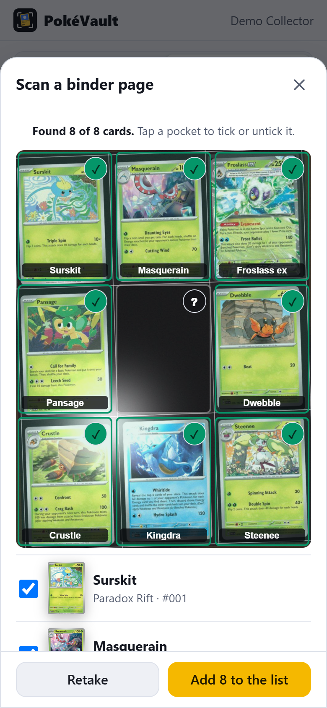
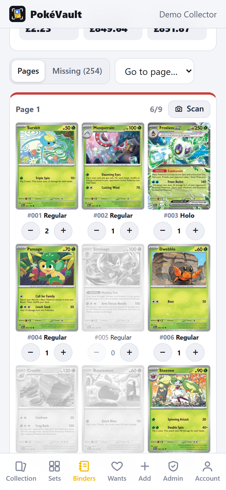
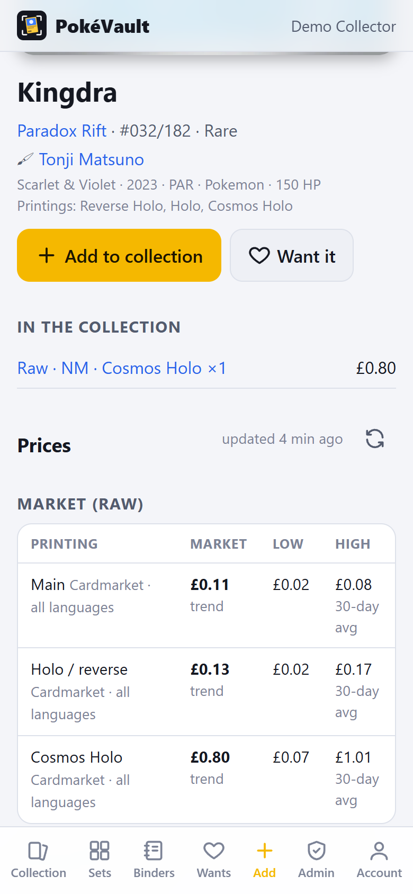
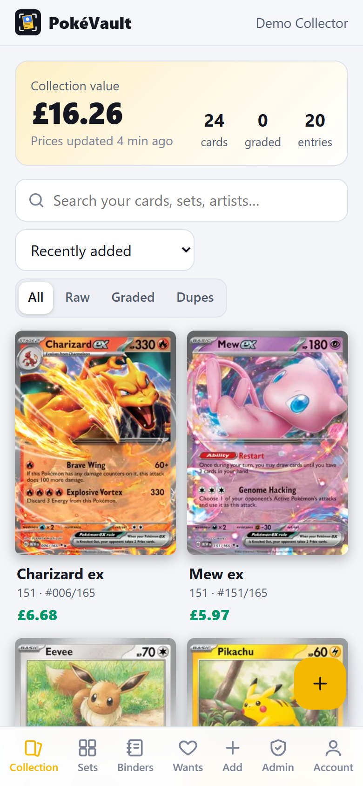
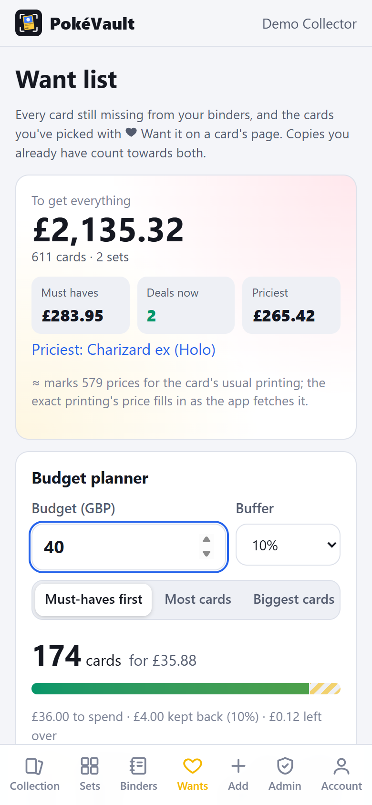
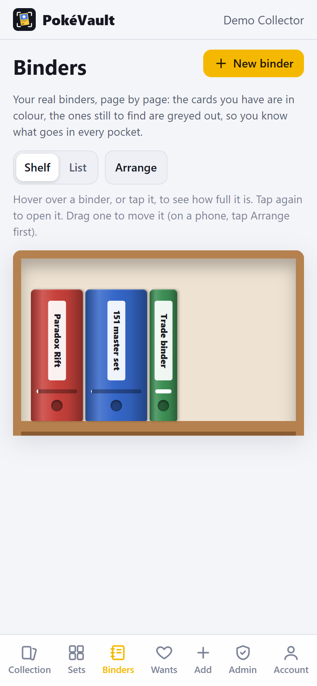
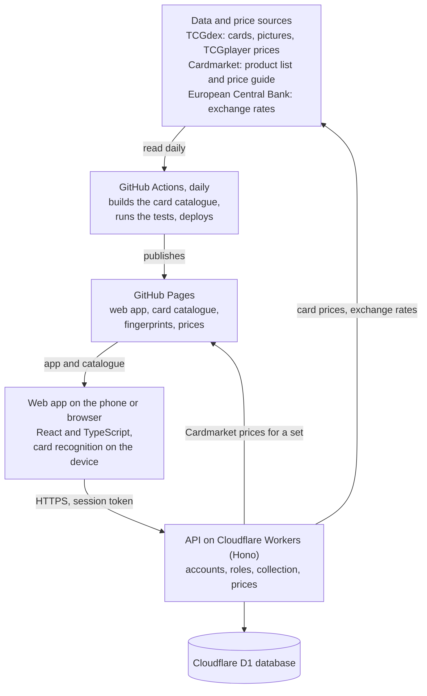

# PokéVault

A phone web app that recognises Pokémon cards from the camera, whether one card or a whole binder page, and tracks a collection's value. It runs on its own API, data pipeline and evaluation harness.

**Developer:** Ryley Griffiths, BSc (Hons) Computer Science, Teesside University London.

## Contents

- [The problem and who it's for](#the-problem-and-who-its-for)
- [Key features](#key-features)
- [Screenshots](#screenshots)
- [Tech stack](#tech-stack)
- [Architecture](#architecture)
- [Getting started](#getting-started)
- [Development](#development)
- [Evaluation](#evaluation)
- [Security and privacy](#security-and-privacy)
- [How it was built](#how-it-was-built)
- [Limitations](#limitations)
- [Next steps](#next-steps)
- [Licence and credits](#licence-and-credits)
- [Contact](#contact)

## The problem and who it's for

Collectors often have thousands of cards in binders. Recording them by hand is slow, and a card's value depends on its exact printing (regular, reverse holo, a stamped promo), its language and its condition. Prices also come from different markets in different currencies.

PokéVault is for individual collectors, or a small group sharing one collection, who want to:

- add cards by pointing a phone at them
- see what the collection is worth
- plan what to buy next

## Key features

- **On-device card recognition.** The phone finds the card in the camera picture, straightens it and matches its picture against about 21,000 cards. When reprints share artwork, it reads the printed number. Photos are never uploaded.
- **Three ways to scan.** One card, a stack (one card after another), or a whole binder page in one photo.
- **Live valuations** from TCGplayer and Cardmarket, plus optional PriceCharting graded prices. They are converted with the European Central Bank's daily rates, and the app keeps its own price history.
- **Binders.**
  - Your real binders, page by page, filled from the collection.
  - Built from a set as one of each card, a master set or a grand master set (every printing, then the promos).
  - One-tap + and − for each pocket.
- **Want list** with a budget planner: it picks the best cards for a budget, keeping a buffer back.
- **Accounts with roles** (Admin, Editor, Viewer, Pending), an audit log, a trash and backups.
- **Installable on a phone** (progressive web app), working offline once loaded.

The [user guide](docs/USER_GUIDE.md) describes every feature.

## Screenshots

All screenshots were taken with made-up data: a "Demo Collector" account on a local copy of the API with its own empty database.

<p>
  
  
  
</p>
<p>
  
  
  
</p>

From left to right, top row first:

1. Scanning a whole binder page.
2. A binder page with + and − for each pocket.
3. A card's printings and prices.
4. The collection.
5. The want list and budget planner.
6. The binder shelf.

## Tech stack

| Area | Technology |
|---|---|
| Web app | React 19, TypeScript 7 (strict), Vite 8; installable progressive web app with a hand-written service worker |
| Card recognition | Custom computer-vision code with no computer-vision library: edge detection, Hough-transform line finding, perspective correction and perceptual hashing (DCT pHash). OCR uses tesseract.js 7 |
| API | Hono 4 on Cloudflare Workers, with Cloudflare D1 (SQLite) and 7 SQL migrations |
| Data pipeline | Node.js script run daily by GitHub Actions: TCGdex REST and GraphQL APIs, Cardmarket's public price files |
| Testing | Node's built-in test runner (136 unit tests), an end-to-end API test, and an evaluation harness in Python (NumPy, Pillow) |
| Hosting and CI/CD | GitHub Pages and GitHub Actions for the web app; Cloudflare for the API |

## Architecture



How the parts fit together:

1. **The data pipeline.** Every day, GitHub Actions runs [`scripts/build-catalog.mjs`](scripts/build-catalog.mjs). It builds the project's own card catalogue from TCGdex (cards, sets, printings and promos), a fingerprint of every card's picture, and prices, including Cardmarket prices whose product links it has checked. It then runs the tests and publishes the catalogue with the web app on GitHub Pages.
2. **The web app** (`web/`) loads that catalogue. Searching for and recognising cards happen on the device, with no calls to third-party APIs. Card pictures are loaded from TCGdex's image server.
3. **The API** (`api/`) is a Cloudflare Worker with a D1 database. It handles accounts, roles, the shared collection, binders, the want list and price history. It refreshes prices for cards in the collection from TCGdex and the published Cardmarket files, hourly and when the app opens.
4. **Shared code** (`shared/`) is used by all three: how a copy is valued, grading scales, printings, picture fingerprints and Cardmarket link checking.

The [data card](docs/DATA_CARD.md) documents each dataset, and the [model card](docs/MODEL_CARD.md) documents the recognition pipeline.

## Getting started

These steps were tested on a fresh clone on Windows 11 with Node.js 24.16.0. You need [Node.js](https://nodejs.org) 22.12 or newer, Git, and an internet connection. No accounts or API keys are needed to run it locally.

On Windows, clone into a short path, for example `C:\code`. The local database file sits deep inside `api\.wrangler`, and Windows limits paths to 260 characters unless long paths are enabled.

```bash
git clone https://github.com/IIRyzII/Pokemon-Card-Scanner.git
cd Pokemon-Card-Scanner
npm ci                       # installs the web app and API (about a minute)
npm run catalog:download     # the published card catalogue, about 2 MB
```

Tell the web app where the local API will be. Create a file `web/.env.local` containing:

```
VITE_API_URL=http://127.0.0.1:8787
```

Then run the API and the web app in two terminals:

```bash
npm run dev:api              # API on http://127.0.0.1:8787 with a local database
```

```bash
npm run dev:web              # web app on http://localhost:5173
```

Open `http://localhost:5173` in a browser and create an account. On a new local database, the first account becomes the admin. Everything stays on your computer.

To publish your own copy online, see [Deploying PokéVault](docs/DEPLOYMENT.md).

## Development

```bash
npm test                     # 136 unit tests (downloads the catalogue first if it's missing)
npm run typecheck            # TypeScript for the web app and the API
npm run build                # production build of the web app
npm run catalog              # rebuild the catalogue from TCGdex instead of downloading it (slow from scratch)
cd api && npm test           # end-to-end API test (see below)
```

- **What the unit tests cover:** how copies are valued, OCR text parsing, search, card finding and picture matching, page scanning, binders and printings, Cardmarket link checking, and the want-list budget planner.
- **The end-to-end API test:** against a running local API, it:
  - registers users and checks that the wrong role or no session is refused
  - adds cards, sales and binders
  - changes passwords and exports backups

  It needs a fresh database (delete `api/.wrangler`, then run `npm run dev:api`) and internet access.

The repository is organised as:

| Folder | Contents |
|---|---|
| `web/` | The web app (React) and the card recognition code (`web/src/scan/`) |
| `api/` | The API (Hono on Cloudflare Workers), its database migrations and the end-to-end test |
| `shared/` | Code used by the web app, the API and the build |
| `scripts/` | The catalogue build and the catalogue download |
| `eval/page-scan/` | The page-scan evaluation harness |
| `docs/` | User guide, deployment guide, data card, model card and screenshots |

## Evaluation

The page scanner was evaluated on simulated photos of binder pages. The photos include sleeves, glare, a page slightly off the guide, empty pockets and cards in the wrong pocket.

Results on a held-out set (60 pages, 468 cards) that wasn't used for tuning:

| Mode | Cards found and ticked correctly | Wrong cards or empty pockets ticked |
|---|---|---|
| Check a binder's page against the cards that belong in it | 92.9% | 0 |
| Read a page of any cards | 85.9% | 0 |

The rest were left for the user to decide ("not sure"), rather than guessed. The photos are simulated from the same pictures the scanner matches against, so real-world accuracy is expected to be lower. It has not yet been measured.

The method, full results and how to reproduce them are in [`eval/page-scan`](eval/page-scan/README.md).

## Security and privacy

- **Photos stay on the device.** Card recognition runs in the browser; the API never receives an image.
- **Passwords never leave the device in plain text.** The browser stretches them with PBKDF2-SHA256 (600,000 iterations), and the server stores only a salted hash of the result.
- **Sessions** are random tokens stored only as hashes. Sign-in and sign-up are rate-limited, and an account locks after 8 wrong passwords.
- **Roles are enforced by the API on every request**, not just hidden in the app. Every change goes into an audit log.
- **No secrets in the repository.** Deployment credentials are GitHub Actions secrets, and the optional PriceCharting token is a Cloudflare secret.

Known gaps in data retention and the live instance are listed in the [data card](docs/DATA_CARD.md#4-accounts-and-collection-database).

## How it was built

I am the developer of PokéVault. I:

- decided what to build and set the requirements
- made the design decisions
- tested the app on real cards and phones, and found and reported defects
- reviewed and approved changes
- deployed it, and I run it

Much of the implementation was written by myself with Enhancements by (Anthropic's Claude Code) working under my direction. I reviewed, tested and integrated its changes.

The project was not built from a template or with a team. It uses the open-source libraries listed under [Tech stack](#tech-stack) and open data from the sources under [Licence and credits](#licence-and-credits).

## Limitations

- Only English cards: the catalogue doesn't include Japanese, Korean or Chinese cards.
- Recognition has been evaluated only on simulated photos, and only for page scanning. The single-card scanner has no reproducible evaluation yet.
- One shared collection per deployment, with no separate per-user collections.
- Prices are approximate. TCGplayer and Cardmarket are different markets, and rarely traded cards have noisy prices.
- The app depends on TCGdex's data and on free hosting tiers.
- No retention clean-up yet for expired sessions and rate-limit records (see the [data card](docs/DATA_CARD.md#4-accounts-and-collection-database)).

## Next steps

- A labelled set of real photos to measure recognition accuracy in practice, including on phones.
- Grading tips, and an estimate of a card's condition from the camera.
- Tracking sealed products.
- Japanese cards.
- A scheduled clean-up of expired sessions and rate-limit records, and a privacy notice for the hosted instance.

## Licence and credits

**All rights reserved.** The source code is published so it can be read and reviewed. It is not licensed for reuse.

- **Card data and pictures** come from [TCGdex](https://tcgdex.dev). Where TCGdex has no picture, the app uses [pokemontcg.io](https://pokemontcg.io)'s.
- **Printings for some older sets** come from [pokemon-tcg-data](https://github.com/PokemonTCG/pokemon-tcg-data).
- **Prices:**
  - TCGplayer prices are as published by TCGdex.
  - [Cardmarket](https://www.cardmarket.com)'s public product list and price guide.
  - Optionally, [PriceCharting](https://www.pricecharting.com).
- **Exchange rates** come from the [European Central Bank](https://www.ecb.europa.eu).
- **OCR** uses [tesseract.js](https://github.com/naptha/tesseract.js) (Apache-2.0).

PokéVault is an unofficial fan project. Pokémon and all related names are trademarks of Nintendo, Creatures and GAME FREAK.

## Contact

Ryley Griffiths: [GitHub profile (IIRyzII)](https://github.com/IIRyzII).
